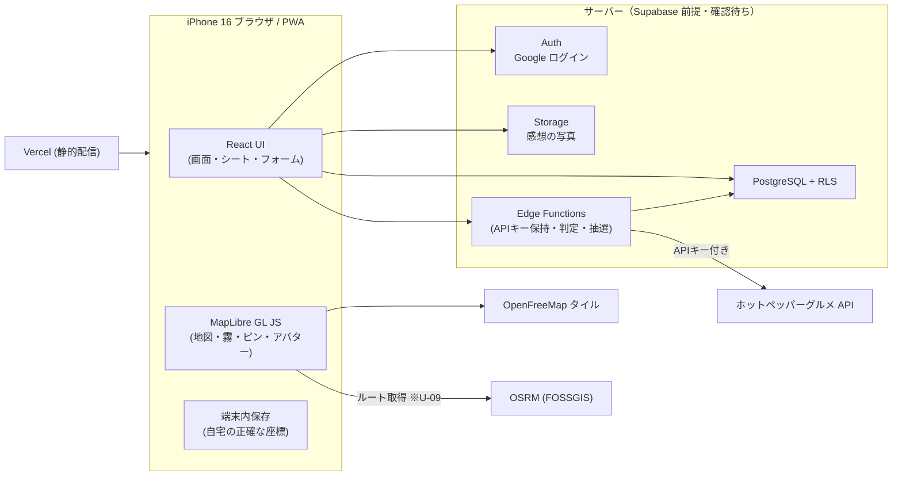
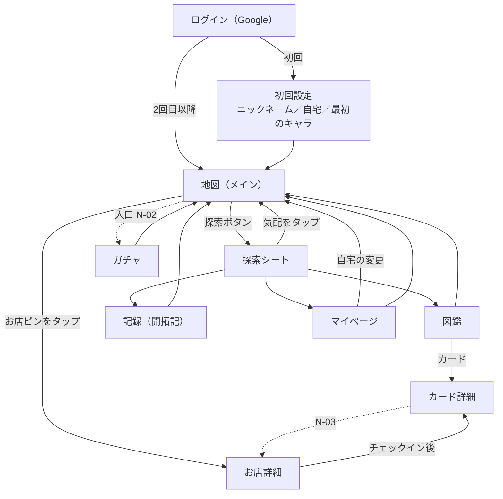
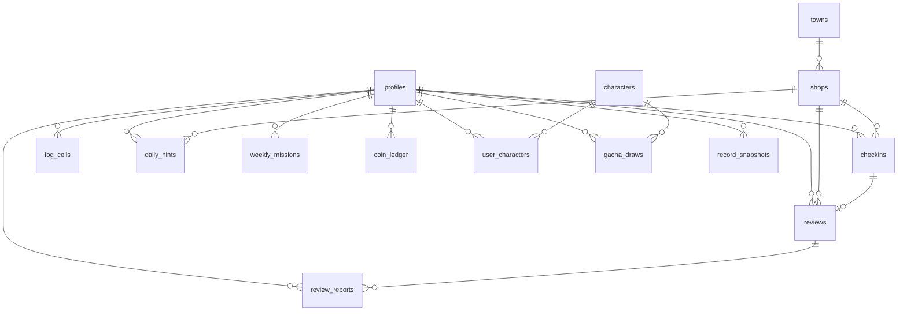

# もぐもGO 基本設計（Cycle 1）

- 位置づけ: 工程「要件定義 → **基本設計** → 詳細設計 → 実装 → 検証 → 振り返り」の基本設計にあたる文書（CLAUDE.md「工程」、SPEC §1.2）。詳細設計（API の入出力、SQL、霧の描画パラメータ等）は本書の後に別文書で行う。
- 情報源: `docs/SPEC.md`（仕様の正本）、`docs/source-dai2an-20261021.md`（上司資料原文）、`docs/PLAN-cycle1.md`（Cycle 1 計画）、`CLAUDE.md`、`docs/learning-log.md`（参考）
- 作成日: 2026-11-05
- ステータス: **ドラフト（ユーザー確認待ち）**
- 表記: 「SPEC §x」は SPEC.md の節、「S数字」は SPEC §5 の論点番号、「PLAN」は PLAN-cycle1.md、「U-xx / N-xx」は末尾の未決定事項。

> **重要な注記（バックエンド未決定）**: SPEC §3.1 では「サーバーは Supabase（無料枠）」と決定されているが、同節に「Supabase のまま進めるか自作 API サーバー寄りにするかの再確認が残っている（Supabase プロジェクト作成前に本人が確定）」とある。本書のサーバー側の記述は **すべて Supabase を前提とするが、ユーザーの確認待ち** である。この決定に依存する項目は末尾「9. 未決定事項」の U 系列に集めた。

---

## 1. システム概要とアーキテクチャ

### 1.1 概要
スマホのブラウザで遊ぶ Web アプリ（PWA。SPEC §2.1・S15）。霧に覆われた地図の上で、自宅（拠点）から半径 1km を開拓する（SPEC §2.5）。チェックインでお店カード（図鑑）を集め、霧を晴らし、デイリーの「気配」と週ミッションをこなし、グルメコインでキャラガチャを回す（SPEC §2.3〜2.6、§5、§8）。検証機は iPhone 16（SPEC §4）。

### 1.2 構成（3層）
| 層 | 中身 | 根拠 |
|---|---|---|
| フロントエンド | React + TypeScript + Vite の SPA。MapLibre GL JS で地図・霧・ピン・アバターを描画。Vercel で HTTPS 配信、PWA | SPEC §3.1、S15、§4（HTTPS） |
| サーバー（※Supabase 前提・確認待ち） | Supabase Auth（Google ログイン）、PostgreSQL（RLS）、Storage（感想の写真）、Edge Functions（秘密が要る処理・改ざん防止が要る処理） | SPEC §3.1、S13、S14 |
| 外部サービス | ホットペッパーグルメ API（サーバー経由のみ）、OpenFreeMap（タイル）、OSRM FOSSGIS 版（ルート） | SPEC §3.1 |

### 1.3 処理の置き場所の原則
learning-log 1件目の整理（ブラウザ側の計算／Edge Functions＝キー秘匿・改ざん防止／DB＝制約・RLS）に従う。

| 置き場所 | 置く処理 |
|---|---|
| ブラウザ | 地図・霧・アバターの描画、GPS 取得と補間、店名明かし（30m）の表示判定、自宅座標の保持、自宅からのルート計算に関わる処理（U-09）、霧セルの算出（U-08 の結論次第）、写真の圧縮、共有画像の合成 |
| Edge Functions（確認待ち） | ホットペッパー API の中継（キー秘匿）、チェックイン確定（50m 判定・カード・コイン・週ミッション・町制覇の連動）、ガチャ抽選、デイリー気配・週ミッションの生成（U-10）、退会（本人データの全削除） |
| DB（確認待ち） | 一意制約・外部キー・値の範囲制約（ニックネーム 10 文字、星の範囲等）、RLS |

コイン残高・ガチャ結果・チェックイン記録はブラウザから直接書けない設計にする（ブラウザは改ざんできるため）。

---

## 2. 画面設計

### 2.1 画面一覧（SPEC S17：実質6画面）
| 画面 | 目的 | 主要要素 | 根拠 |
|---|---|---|---|
| **地図（メイン）** | 霧の地図を歩いて開拓する | 斜め見下ろし（PLAN: pitch 55°）／中央に人アバター＋影＋検知サークル／もこもこの雲の霧／お店ピン（ジャンルの可愛いアイコン）／気配ピン（霧の中、アイコンに「？」を重ねてぼかす）／下部中央の大きな丸ボタン「探索」→ **探索シート**／出典表示 | S17、S16、§8 アバター、§3.1 出典 |
| └ 探索シート（地図上のシート） | 今日やることを選ぶ | 今日の気配3件（タップでカメラがその場所へ移動）／週ミッションの進捗（週3軒）／図鑑・記録・マイページへの入口／気配なしの日は「今日は気配なし」＋近くの未訪問店を通常ピンで案内 | S17、S5、S4、S15 |
| **お店詳細** | 店を知り、チェックインし、感想を残す | 公式写真・ジャンル・キャッチ・予算（ホットペッパー由来）／チェックインボタン（店から 50m 以内で有効）／みんなの感想と星（ニックネーム表示）／自分の感想の投稿・編集・削除（写真1枚まで任意）／通報ボタン | S3、S12、S13、S14 |
| **図鑑** | 行った店のカードを集めて眺める | 一覧＝お店の公式画像の台紙。未訪問カードは店名を伏せ、ジャンルと個性ヒントのみ（霧で隠す）／カード詳細＝スクラップブック風に自分の写真をピン留め。項目は店名・公式写真・自分の写真（最新訪問）・訪問日・星・ひとこと・町の名前／図鑑カード画像の共有 | S11、S14、S15、§8 図鑑詳細 |
| **記録（開拓記）** | 開拓の成長を振り返る | 現在の地図＋週次サムネイル＋開拓率・軒数の数字カード／制覇・開拓マップ画像の共有 | S6、S14、§2.6 |
| **マイページ** | 自分の設定 | ニックネーム（10文字まで・変更可・重複可）／自宅の変更（現在地ボタン＋地図で微調整）／ログアウト／退会（本人データも消える） | S15、S13 |
| **ガチャ** | コインでキャラを引く | コイン残高／1回（100コイン）・10連／排出演出・結果／所持キャラ（N-07） | §8 キャラガチャ |

画面以外のフロー: **ログイン**（Google）→ **初回設定**（ニックネーム、自宅設定、最初のキャラを男の子・女の子の2体から選ぶ）（S13、S15、§8）。初回設定を独立画面にするか地図上のシート／モーダルにするかは N-01。記録の開始時点は「自宅設定の完了時点」（S6）。

### 2.2 画面遷移

- ガチャ画面への入口は SPEC に記載が無い（探索シートの入口は図鑑・記録・マイページのみ。S17）→ N-02。
- 気配ピン（店名未判明）をタップしたときにお店詳細を開くか → N-04。
- チェックイン後の遷移（カード入手演出 → カード詳細、など）は N-05。

### 2.3 状態管理の方針
- **React の state に入れるもの**: 表示中の画面、シートの開閉、選択中の店、フォーム入力、サーバーから取得した一覧（気配・ミッション・図鑑・感想・残高）。
- **React の state に入れないもの**: 地図のカメラ（中心・ズーム・傾き）、GPS の生の位置と補間後の位置、アバターのアニメーションのコマ、霧のマスク。これらは MapLibre インスタンスと ref／React 外のモジュールに持つ（PLAN 技術リスク、SPEC §3.1「地図移動で React を再描画しない」）。
- 位置に依存する UI（チェックインボタンの有効化 50m、店名明かし 30m）は、**しきい値をまたいだ瞬間だけ** React に通知する（毎秒の位置更新で再描画しない）。
- ルーティング・状態管理・データ取得のライブラリ選定は未導入（CLAUDE.md 現状）→ N-12。

---

## 3. データ設計

> ※テーブル・RLS は Supabase（PostgreSQL）前提、ユーザーの確認待ち（U-01〜U-04）。

### 3.1 自宅座標の扱い（最重要）
- **自宅の正確な座標は端末内のみに保存し、サーバーへ絶対に送らない。どのテーブルにも持たない**（S15「自宅の正確な座標は端末内のみ保存」、SPEC §2.5）。
- 端末内の保存先（localStorage／IndexedDB）は N-13。機種変更時は自宅を再設定する（座標がサーバーに無いため）。
- 注意: 「自宅座標を持たない」だけでは足りない。自宅を中心とする霧セル・自宅起点のルート・自宅を中心とした店検索の範囲がサーバーに届くと、自宅の位置が推定できる。これは SPEC S8 で「自宅座標そのものをサーバーに置くか、霧の状態だけを置くかは技術選定で詰める」と残っている論点であり、U-08・U-09・U-10 で扱う。

### 3.2 エンティティ一覧
| テーブル | 主要フィールド | 内容・根拠 |
|---|---|---|
| profiles | user_id（認証ユーザーと1対1）, nickname（10文字以内・重複可）, starter_character_id, record_started_at, created_at | S13・S15。**自宅座標の列は作らない** |
| shops | shop_id（ホットペッパーの店舗 ID）, name, lat, lng, genre, catch, budget, photo_url, town_id, fetched_at | ホットペッパー由来のキャッシュ。名前が無い店は保存・表示しない（S9）。保存の可否・期間は規約次第（N-10） |
| towns | town_id, name, 区域の形 | 町制覇（S2 ③）用。町・丁目の境界データの出典は未決定（N-09） |
| checkins | checkin_id, user_id, shop_id, checked_in_at, was_hint（気配の店か）, lat/lng（チェックイン時の現在地。保存要否 U-08） | S3。図鑑カードの元データ |
| reviews | review_id, user_id, shop_id, checkin_id, stars, body, photo_path（0〜1枚）, created_at, updated_at, hidden（管理者削除用） | S12・S13・S14。**公開。表示はニックネーム**（本名は出さない）。1チェックインに1件か・店ごとに1件かは N-06 |
| review_reports | report_id, review_id, reporter_id, created_at | S13 通報。対応は Supabase 管理画面で手作業 |
| fog_cells | user_id, cell_id（25m セル）, source（店周り／ルート／町制覇）, cleared_at | S2・S15。保存範囲は U-08 |
| daily_hints | user_id, date, slot（1〜3）, shop_id, hint_genre（曖昧表示）, hint_text（キャッチ断片＋予算帯）, is_mystery（謎の気配）, status | S4・S5。翌朝リセット（S15） |
| weekly_missions | user_id, week_start, condition_type（5種）, condition_params, target（3）, progress, completed_at | S4・S15。週の区切り N-08 |
| coin_ledger | entry_id, user_id, amount, reason（チェックイン／気配ボーナス／週ミッション／町制覇／ガチャ消費）, ref_id, created_at | §8。残高は台帳の合計（キャッシュ列を持つかは詳細設計） |
| characters | character_id（1〜30）, name, rarity（3〜5）, sprite_path | §8 マスタ。★5＝1〜4、★4＝5〜12、★3＝13〜30 |
| user_characters | user_id, character_id, obtained_at, duplicate_count | §8。ダブりの変換先は N-07 |
| gacha_draws | draw_id, user_id, drawn_at, draw_type（単発／10連）, character_id, rarity, pity_count（天井カウンタ） | §8 確定枠・天井の判定に使う |
| record_snapshots | user_id, week_index, 開拓率, 軒数, 達成クエスト数, 地図スナップショット（形式 N-11） | S6 |

町制覇の進捗（町内の店のうち訪問した割合）は checkins と shops.town_id から導出し、専用テーブルは持たない方針（詳細設計で再確認）。

### 3.3 グルメコインとガチャ（SPEC §8「キャラガチャを初版から入れる」から転記）
| 項目 | 値 |
|---|---|
| 通貨名 | グルメコイン |
| 付与: チェックイン | 30 |
| 付与: 気配の店へのチェックイン | ボーナス +10 で 40 |
| 付与: 週ミッション達成 | 100 |
| 付与: 町の制覇 | 100 |
| ガチャ1回 | 100 コイン |
| 排出率 | ★3 70%／★4 25%／★5 5% |
| 10連 | あり |
| 確定枠 | 10連で★4以上1体確定 |
| 天井 | 累計30回で★5確定 |
| 排出物 | 新しいキャラのみ（衣装は出さない）。課金ガチャは無し |
| 初期プール | 候補30体全員（★5＝1〜4、★4＝5〜12、★3＝13〜30）。SPEC §8「キャラデザイン試作と採用」 |
| 色違い | 初期プールに入れない |

- SPEC に数値が無いもの: 10連の価格（1000 コインか割引か）、天井カウンタのリセット条件（★5 排出時に戻すか）、確定枠と天井が重なったときの扱い → N-07。
- **SPEC と PLAN の矛盾**: PLAN スコープは初期プールを「追加キャラ2体程度」としているが、SPEC §8 は同日夜に「候補30体全員」へ変更済み → N-14（本書では SPEC を表に載せたが、確定はユーザー確認）。
- ダブりの扱い: SPEC は「色違い・称号などに化ける形を基本」としつつ「色違いキャラは初期プールに入れない」「色違いは必要時に導入可（未決定）」→ N-07。
- 抽選・残高の減算・付与はサーバー側で1トランザクションとして行い、ブラウザからは結果の参照のみ（改ざん防止）。

### 3.4 RLS 方針の概要（※Supabase 前提・確認待ち）
| テーブル | 読む | 書く |
|---|---|---|
| profiles | 本人は全列。他人には nickname のみ（感想表示用。公開用ビュー等で列を絞る） | 本人が nickname・starter_character_id を更新 |
| shops / towns / characters | ログインユーザーが読める | サーバー（Edge Functions）のみ |
| checkins / coin_ledger / gacha_draws / user_characters / fog_cells / daily_hints / weekly_missions / record_snapshots | 本人のみ | サーバー（Edge Functions）のみ。fog_cells・record_snapshots を本人書き込みにするかは U-08・N-11 |
| reviews | hidden でない行はログインユーザー全員が読める（ニックネーム付き。未ログインには見せない【決定 2026-11-05、詳細設計 D-02】） | 本人が自分の行を作成・編集・削除 |
| review_reports | 一般ユーザーは読めない（管理者は管理画面で確認） | 本人が通報を作成 |
| Storage（感想の写真） | 非公開の保存場所。ログインユーザーが、自分の写真と非表示でない感想の写真を期限付き URL で見る【決定 2026-11-05、詳細設計 D-20。当初案「公開」から変更】 | 本人のフォルダにのみアップロード・削除 |

- 管理者削除は Supabase 管理画面から手作業（S13）。管理者用のアプリ画面は作らない。
- 退会時は本人の全行と写真を削除する（S13）。reviews に通報が付いている場合の扱いは詳細設計。

---

## 4. 外部連携

### 4.1 ホットペッパーグルメ API（お店データ。SPEC §3.1）
- **呼び出し元はサーバー側のみ**（Edge Functions。※Supabase 前提・確認待ち）。ブラウザは自前のサーバー関数を呼び、関数がキーを付けてホットペッパーへ問い合わせる（PLAN「キーはサーバー側＝Supabase Edge Functions 経由」）。
- 使うデータ: 店名・位置・ジャンル・キャッチ・予算・写真（S5 の個性ヒント、S11 の公式画像）。
- データの性質: 掲載店のみ／評価なし／商用不可（学習・個人利用の範囲）（SPEC §3.1）。名前の無い店は対象外、閉店した店は初版ではそのまま出す（S9）。
- 検索範囲: お店の表示は現在地から 1km 以内（S1）。一方、開拓・気配の対象は自宅から 1km（§2.5、S10）で、PLAN は「自宅中心1kmのお店ピン」と書いている → 矛盾の可能性 N-15。自宅中心の検索はサーバーに自宅付近の位置を送ることになる → U-10。
- 利用規約上のクレジット表示義務・呼び出し回数の上限・取得データの保存の可否は SPEC に記載が無い → N-10（要確認）。
- 障害時: 取得済みの shops キャッシュで表示を続け、取得できない旨を表示する（詳細は詳細設計）。

### 4.2 OpenFreeMap（地図タイル。SPEC §3.1）
- 呼び出し元: ブラウザ（MapLibre）から直接。登録・キー・カード不要。
- 義務: 出典表示（OpenFreeMap／OpenMapTiles／OpenStreetMap）。**【変更 2026-11-06】地図の上には常時出さず、起動時のスプラッシュの右下と「出典」ボタン（後でマイページ）で示す**（SPEC §9、OSMF Attribution Guidelines）。
- 見た目: 【2026-11-06】土台は文字やお店の印が少ない positron。色は `src/map/infra/themes.ts` の案（sky／mint／pop）を上から当てる。標準は pop（本人決定 2026-11-06。大きい道路は淡いクリーム色）。URL の `?theme=` で見比べられる。
- 障害時: 無保証・予告なく止まる可能性があるため、**タイルの出どころは設定1か所で差し替え可能**にする（逃げ先＝Protomaps 自前配布）。スタイルは自前 JSON で「明るい昼のグルメ」に寄せる。

### 4.3 OSRM（FOSSGIS 版。ルート。SPEC §3.1、S2 ②）
- 用途: 自宅から店までの道沿いルートを引き、帯状に霧を晴らす（実際に歩いた道ではない）。自宅圏外の店ではルートを引かない（S10）。
- 制限: キー不要、**1回/秒までの節度利用**。チェックイン1回につき1回程度の呼び出しに抑え、結果は再利用する。
- 呼び出し元: ルートの起点は自宅座標のため、自前サーバーを経由させない（自宅座標をサーバーへ送らない原則）。ブラウザから直接呼ぶ案が自然だが、その場合も自宅座標は第三者（FOSSGIS）には届く → U-09。
- 障害時: ルートが取れなくても、チェックイン本体（店周り 200m・カード・コイン）は成立させ、ルートだけ後で再試行する案（詳細設計で確定）。

---

## 5. マップ／アバター／霧のフロントエンド構造

### 5.1 責務分担（PLAN「技術リスクと作法」）
| 部品 | 持ち主 | React との関係 |
|---|---|---|
| 地図・カメラ | MapLibre インスタンス（ref で保持） | 地図の移動・ズーム・傾けで React を再描画しない |
| お店ピン・気配ピン | MapLibre の **GeoJSON source ＋ symbol/circle layer** | **DOM マーカーで大量に置かない**。データ更新時だけ source を差し替える |
| アバター | MapLibre 側（5.2） | 位置とコマは React state に入れない |
| 霧 | MapLibre 側のレイヤー（5.3） | 晴れたセルが変わったときだけ更新 |
| GPS | `watchPosition`（約1秒間隔。SPEC §8）を React 外で受ける | しきい値（50m／30m）をまたいだときだけ React へ通知 |

- ピンのアイコンはジャンル別の可愛いアイコン（S16）。晴れた範囲のピンは明確に、霧の中の気配ピンは「？」を重ねてぼかす。店名明かしは店から 30m 以内（S5）、チェックインは 50m 以内（S3）で別ルール。
- 地図の表示: 傾け 45〜60°対応（SPEC §3.1）、PLAN では pitch 55°。PLAN の「自宅（経堂）周辺」は開発時の検証地点であり、仕様は「誰でも自分の自宅を設定できる汎用仕様」（§2.5）なので、固定値としては持たない。

### 5.2 アバター（SPEC §8「アバターは2Dスプライト・4方向」「アバターは歩く」）
- 決まっていること: 2D スプライトシート、上下左右4方向×歩行コマ＋待機ポーズ、**1秒8コマ目安**、歩行に小さな上下動、足元に影と検知サークル。移動中は歩き、停止中は待機。GPS 更新の間は位置を補間して滑らかに動かす。3D は不採用。メインのアバターは人型（キリンのポコタンは使わない）。
- 補間: GPS の生の位置を目標点とし、描画ループ（requestAnimationFrame）で現在の表示位置を目標へ寄せる。GPS の飛びをならす具体的な方式（平滑化の強さ、精度の低い測位の捨て方）は詳細設計。
- 向き: 移動ベクトルから4方向を選ぶ。地図を回転・傾けた状態での画面上の向きの基準は詳細設計。
- **描画方式は未決定**（SPEC/PLAN は「レイヤー／マーカー側で持つ」までで方式の指定なし）→ N-16。候補:
  1. MapLibre の Marker（DOM 要素1個のみ）＋CSS のコマ送り。1体だけなので「ピンを DOM で大量に置かない」には反しない。
  2. symbol layer でアイコン画像をコマごとに切り替える。
  3. MapLibre のカスタムレイヤー（WebGL）で描く。
- 検知サークルの半径（30m の店名明かしに合わせるか 50m のチェックイン距離に合わせるか）は SPEC に無い → N-17。

### 5.3 霧（もこもこの雲。SPEC §2.2、S2、S15、S17）
- 内部管理: **25m 四方のセル（グリッド）**。円（店周り 200m）・ルート（自宅→店の道沿いの帯）・町制覇（町全体）はすべてセルで判定（S15）。開拓率は自宅 1km 円内のセルのうち晴れたセルの割合（S2 の「1回で約4%」は面積比の考え方）。
- 表示: **見た目は不定形**（雲が晴れるような有機的な形、境界はグラデーション）。内部のセルと表示を分離する（SPEC §2.2 技術含み）。世界観は「もこもこの雲」（S17、CLAUDE.md）。
- 晴れる契機は3層のみ（歩行では晴れない。S7）: ①チェックインで店の周り 200m ②自宅から店までのルート沿い（自宅圏内の店のみ）③町内の店の半分以上に行くと町全体。
- 「霧の世界＝晴れていない場所の店は見えない」の約束事（S1）に合わせ、霧の中の店は通常ピンでは出さない（気配ピンと「気配なし」の日の案内を除く。S5・S15）。
- **描画方式は未決定** → N-18。候補:
  1. MapLibre のカスタムレイヤー（WebGL）で、晴れセルのマスクをぼかし＋雲テクスチャで描く（傾け表示と一番相性がよい）。
  2. Canvas に霧を描き、canvas/image source として地図座標に貼る。
  3. GeoJSON の fill レイヤー（晴れ領域を穴にした多角形）＋縁のぼかし表現。
  詳細設計で iPhone 16 の試作により決める（地図の見た目の試行錯誤は通常の進め方でよい。CLAUDE.md）。
- 開拓データとの関係: 霧の表示は「晴れセル集合」から作る。晴れセル集合をサーバーに保存するか、チェックイン履歴と自宅座標から端末で毎回組み立てるかは U-08。

---

## 6. 処理の流れ（主要2件）

### 6.1 チェックイン（S3、PLAN スコープ）
1. ブラウザ: 店から 50m 以内でチェックインボタンが有効になる。
2. ブラウザ → サーバー関数（※確認待ち）: 店 ID と現在地を送る（**自宅座標は送らない**）。
3. サーバー: 50m 判定 → checkins 登録 → コイン付与（30、気配の店なら 40）→ 週ミッション進捗 → 町制覇判定（制覇なら +100）→ 結果を返す。
4. ブラウザ: カード入手の表示、店周り 200m の霧晴れ、（自宅圏内なら）OSRM でルート取得 → ルート沿いの霧晴れ。
- GPS の偽装は防げない前提（判定はサーバーでも、送られる位置そのものは端末由来）。

### 6.2 デイリー気配・週ミッション（S4、S5、S10、S15）
- 毎朝、霧の中の未訪問店から3件。ジャンルは曖昧表示、ヒントはキャッチ断片＋予算帯、ジャンル不明はたまに「謎の気配」。選ばなかった気配は翌朝リセット。気配の店が無い日は「今日は気配なし」＋近くの未訪問店を通常ピンで案内。自宅圏外にいるときは今いる場所の周りからも出す。
- 週ミッションは条件プール5種（ジャンル指定／初めての店／自宅から500m以上先／同じ町で2軒／気配の店）から抽選、目標は週3軒、気配の店も条件に合えば二重カウント可。
- 「霧の中」「自宅から500m以上先」「自宅圏外か」の判定はいずれも自宅座標が要る。サーバーで生成するとサーバーが自宅を知る必要が出る → U-10。「毎朝」の切り替え時刻（JST 0時か等）は N-08。
- 気配の店の店名をブラウザに渡すと、30m に入る前に店名を覗ける。店名を 30m 到達まで渡さない作りにするかは N-04。

---

## 7. 非機能要件

### 7.1 秘密情報（APIキー等）の保持場所と出さない場所（上司資料 §4、SPEC §4.1、CLAUDE.md）
| 秘密 | 保持場所 | 出さない場所 |
|---|---|---|
| ホットペッパー API キー | サーバー側のシークレット（Supabase Edge Functions のシークレット。※確認待ち U-05）。開発時はローカルの `.env`（コミットしない） | **ブラウザに届けない**: フロントのバンドル（Vite の公開用環境変数にしない）、関数のレスポンス（エラー時に問い合わせ URL をそのまま返さない）、ログ（キー付き URL を出力しない）、Git 履歴、AI の会話（`.env` は読ませない） |
| Supabase service_role キー | サーバー側（Edge Functions の環境）のみ | ブラウザ側コードには絶対に入れない |
| Supabase の公開用キー（anon） | ブラウザに入れてよい（公開前提）。守りは RLS で行う | — |
| Google ログインの OAuth 設定 | 認証基盤の管理画面（※確認待ち） | ソース・リポジトリ |

- 守りの仕組み: `.env` は settings の deny で読ませない／コミット前に `scripts/check-secrets.sh`（pre-commit）で機械検査／Sandbox 内で開発（CLAUDE.md）。AI がキーを直書きしかけた等の事例は苦労日誌に残す（上司資料 §4）。
- OpenFreeMap と OSRM はキー不要のため秘密は無い。

### 7.2 個人情報
- 自宅の正確な座標は端末内のみ（3.1）。自宅位置が推定できる派生データの扱いは U-08〜U-10。
- 感想の公開はニックネームのみ。Google アカウントの本名は出さない（S13）。
- 感想の写真は端末で 150〜250KB に圧縮してからアップロード（SPEC §3.1）。圧縮時の再エンコードで撮影位置等のメタデータが残らないことを確認する（詳細設計の確認項目）。
- 退会で本人のデータを消す（S13）。

### 7.3 完全無料での運用（SPEC §3、§3.1、PLAN）
| サービス | 本書で前提にする制約 | 出典 |
|---|---|---|
| Supabase 無料枠（確認待ち） | 約1週間の低活動で一時停止（警告メールあり・1年以内は復旧可）／写真の転送量 月5GB → 150〜250KB に圧縮／東京リージョン／自動バックアップ無し → ダンプ・書き出しスクリプトを用意 | SPEC §3.1、PLAN |
| Vercel | 無料で配信、HTTPS（位置情報の前提） | SPEC §3.1、§4 |
| OpenFreeMap | 無料・無保証 | SPEC §3.1 |
| OSRM FOSSGIS | 無料・1回/秒まで | SPEC §3.1 |
| ホットペッパー | 無料・商用不可 | SPEC §3.1 |
- Google Maps Platform は請求アカウントが必須のため使わない（SPEC §3）。
- DB 容量・関数の呼び出し回数など、SPEC に無い無料枠の数値は U-07 で確認する。受け入れ条件「無料枠の範囲で動いている」（PLAN）の物差しになる。

### 7.4 性能（iPhone 16）
- PLAN 受け入れ条件: ①地図のスクロール・ズーム・傾けが引っかからずヌルヌル動く ②歩いてもアバターがブレずに歩行アニメでついてくる。SPEC: 実機でヌルヌル動くこと、スプライト 1秒8コマ、GPS 約1秒間隔。
- 数値の目標は SPEC/PLAN に無い。**目標案（未決定 N-19）**: 地図操作中 60fps を目標、少なくとも体感で引っかからないこと／店ピンは数百件でもレイヤー描画で維持（SPEC §3.1 の「数十〜数百件」規模）。
- iPhone 16 のブラウザ（Safari か等）は「要確認」のまま（SPEC §4、§6-2）→ N-20。

### 7.5 その他
- HTTPS 必須（位置情報）。実機確認は Vercel のプレビュー URL（PLAN）。
- PWA（ホーム画面追加）対応（S15）。
- 画面を消すと位置が取れない問題は、歩行記録をやめたことで解消済み（S7）。

---

## 8. Cycle 1 での実装順との対応（PLAN「積む順番」）
1 土台 → 2 サーバー（※確認待ち）＋Google ログイン＋基本テーブル（3.2）→ 3 地図・傾け・現在地追従・アバター（5.1〜5.2）→ 4 お店ピン・チェックイン・霧（4.1、5.3、6.1）→ 5 気配・ミッション・図鑑・感想・記録（6.2、2.1）→ 6 ガチャ・共有画像・PWA（3.3）→ 7 iPhone 16 で通し確認（7.4）。記録の仕組みは早い周に入れる（SPEC §2.6）。

---

## 9. 未決定事項

### 9.1 バックエンドの選択に依存するもの（U 系列）
全項目が「Supabase のまま進めるか、自作 API サーバー寄りにするか」（SPEC §3.1 再確認事項）に依存する。

| ID | 内容 | 依存する決定 | 影響する節 | 選択肢 |
|---|---|---|---|---|
| U-01 | バックエンドの方式そのもの | 本人の確定（Supabase プロジェクト作成前） | 全体、1.2、3、4.1、7 | (a) Supabase のみ (b) Supabase＋一部を自作 API (c) 自作 API サーバー＋別 DB（次点 Neon。SPEC §3.1） |
| U-02 | 認証方式（Google ログインの実現手段） | U-01 | 2.2、3.4、7.1 | (a) Supabase Auth (b) 自作サーバーで Google OAuth を処理 |
| U-03 | DB の種類と型（地理データの持ち方：緯度経度の数値列か地理型拡張か） | U-01 | 3.2 | (a) PostgreSQL＋数値列 (b) PostgreSQL＋地理型拡張 (c) その他 |
| U-04 | 権限の守り方（RLS か API 層での認可か） | U-01 | 3.4 | (a) RLS（ブラウザから DB 直接） (b) API サーバーで認可、DB は非公開 (c) 併用 |
| U-05 | サーバー処理の置き場とシークレットの置き場 | U-01 | 1.3、4.1、7.1 | (a) Edge Functions＋そのシークレット (b) 自作サーバーの環境変数（ホスティング先は未定） |
| U-06 | 写真ストレージ | U-01 | 3.2、3.4、7.3 | (a) Supabase Storage (b) 別の無料ストレージ |
| U-07 | 無料枠の数値（DB 容量・関数呼び出し回数・停止条件など SPEC 未記載分）と監視方法 | U-01 | 7.3 | 選んだサービスの公式情報で確認して本書に追記 |
| U-08 | 霧の状態のサーバー保存範囲（ルート・自宅周りのセルから自宅位置が推定できる問題）。SPEC S8 の残件 | U-01、U-04 | 3.1、3.2、5.3 | (a) 晴れセルを全部サーバー保存 (b) サーバーはチェックイン履歴のみ、霧は端末で自宅座標から再構成 (c) ルート由来のセルだけ端末保存。**【決定 2026-11-05】(c)**：ルート由来は端末内のみ、機種変更時は checkins から引き直し（詳細設計 D-06） |
| U-09 | OSRM の呼び出し元（自宅座標が第三者に届く点の扱い） | U-01、U-08 | 4.3 | (a) ブラウザから直接（自前サーバーには届かない） (b) 自前サーバー経由（自宅座標がサーバーに届くため原則に反する） |
| U-10 | 自宅 1km の店取得・気配生成・週ミッション判定を、自宅座標を渡さずにどう行うか | U-01、U-08 | 4.1、6.2 | **【決定 2026-11-05】気配は端末が候補リスト→サーバーが抽選、500m条件は端末の申告（詳細設計 D-16 / D-17）。** (a) 端末で生成し、サーバーは粗い範囲（例: 広めの区画）で店を返す (b) 現在地基準の取得を積み重ねて端末で絞る (c) 自宅の概略位置のサーバー保存を本人に再確認する |
| U-11 | 改ざん防止の処理（チェックイン確定・コイン付与・ガチャ抽選）の実装場所 | U-01 | 1.3、3.3、6.1 | (a) Edge Functions (b) DB 関数 (c) 自作 API |
| U-12 | 退会処理（認証ユーザーと全データ・写真の削除）の実装手段 | U-01、U-02 | 3.4 | (a) サーバー関数で一括削除 (b) DB の連鎖削除＋関数 |
| U-13 | 管理者削除の運用（S13 は「Supabase の管理画面で手作業」と決定済みだが、方式が変わると前提が崩れる） | U-01 | 3.4 | (a) Supabase 管理画面 (b) 自作サーバーなら DB クライアント等で手作業 |
| U-14 | バックアップ（無料枠に自動バックアップ無し。PLAN） | U-01 | 7.3 | (a) 手動ダンプスクリプト (b) 定期書き出し |

### 9.2 バックエンド以外で SPEC/PLAN から決められなかったもの（N 系列）
| ID | 内容 | 影響する節 | 選択肢・メモ |
|---|---|---|---|
| N-01 | ログイン・初回設定を独立画面にするか、地図上のシート／モーダルにするか（SPEC は「実質6画面」） | 2.1、2.2 | **【決定 2026-11-06】独立画面を1つずつ（① ニックネーム → ② 最初のキャラ → ③ 自宅）。URL は /setup/name・/setup/character・/setup/home**。設計 docs/superpowers/specs/2026-11-06-initial-setup-design.md |
| N-02 | ガチャ画面への入口（探索シートの入口に記載なし。S17） | 2.2 | 探索シートに追加／地図上のボタン／マイページ |
| N-03 | 図鑑のカード詳細からお店詳細へ行けるか | 2.2 | 行ける／行けない |
| N-04 | 気配ピン（店名未判明）のタップでお店詳細を開くか、店名を 30m 到達までブラウザに渡さないか | 2.2、6.2 | **【決定 2026-11-05】店名は端末の画面で伏せるだけ（データは届く）。** 詳細は開かない／伏せた詳細を出す。店名はサーバーが 30m 到達時に返す／端末で隠すだけ |
| N-05 | チェックイン後の画面の流れ（カード入手演出・コイン表示） | 2.2 | 詳細設計で決める |
| N-06 | 感想は「1チェックインに1件」か「1店につき1件（再訪で更新）」か。図鑑の「ひとこと」が感想本文と同じものか | 3.2、2.1 | S14「1回の感想に1枚」、「複数回行った店は最新の訪問の写真」が手がかり |
| N-07 | ガチャの細部: 10連の価格、天井のリセット条件、確定枠と天井の重なり、ダブりの変換先（色違いは初期プールに入れない決定との関係）、所持キャラ一覧とアバター変更の置き場所 | 3.3、2.1 | SPEC §8 に数値・規則なし |
| N-08 | 日と週の区切り（デイリーのリセット時刻、週ミッション・週次記録の週の始まり曜日） | 6.2、3.2 | JST 0時／朝の指定時刻、月曜始まり／自宅設定日起点 |
| N-09 | 町（町・丁目）の境界データの出典と、店を町に割り当てる方法 | 3.2、5.3 | SPEC に出典の記載なし。無料で使える公的な境界データ等を調査 |
| N-10 | ホットペッパー API の利用規約: クレジット表示義務、呼び出し上限、取得データの保存（キャッシュ）可否と期間 | 4.1、3.2 | SPEC に記載なし。規約を確認して反映 |
| N-11 | 記録の地図スナップショットの形式と保存場所（画像として保存か、当時の晴れセルを保存して再描画か） | 3.2、2.1 | 自宅位置の推定問題（U-08）とも関係 |
| N-12 | ルーティング・状態管理・データ取得のライブラリ選定 | 2.3 | CLAUDE.md「未導入」 |
| N-13 | 自宅座標の端末内の保存先 | 3.1 | localStorage／IndexedDB |
| N-14 | **SPEC と PLAN の矛盾**: ガチャ初期プール（PLAN「追加キャラ2体程度、周ごとに足す」 vs SPEC §8「候補30体全員」） | 3.3 | **【決定 2026-11-05】SPEC どおり候補30体全員**。PLAN を更新済み。Cycle 1 のガチャ完成は30体分の歩行シート（シロ）が前提 |
| N-15 | **SPEC と PLAN の矛盾の可能性**: お店ピンの範囲（PLAN「自宅中心1km」 vs SPEC S1「現在地から 1km 以内」） | 4.1、5.1 | **【決定 2026-11-05】SPEC S1 どおり、ピンは現在地から1km**。自宅1kmは探索（霧・クエスト）の範囲。PLAN を更新済み |
| N-16 | アバターの描画方式 | 5.2 | DOM マーカー1個＋CSS／symbol layer／カスタムレイヤー |
| N-17 | 検知サークルの半径 | 5.2 | **【決定 2026-11-05】50m（チェックイン距離に合わせる）。** 30m／50m／見た目だけ |
| N-18 | 霧（もこもこの雲）の描画方式 | 5.3 | カスタムレイヤー／canvas source／fill レイヤー。iPhone 16 で試作。**【決定 2026-11-06 本人: B。「もう少し雲のような可愛い形に」→ アニメ調の雲に作り直して確認中】** A（25m マスを fill で塗る）はカクカクで霧に見えない。B（canvas source に雲を描き、晴れた場所を柔らかい円で消して縁に雲の土手を足す）が「もこもこ」に近く、傾けても崩れず、霧の中の立体の建物も隠れる。描き直しは晴れたマスが変わったときだけで軽い。課題: 雲の粒が丸く均一に見える（シロに雲の質感の素材を頼むと上がる）、寄りで少しぼやける（現在地の周りを細かく描き直す工夫が要る）。おすすめは B。**【2026-11-06 本人が見本を指定】** `art/reference/fog-and-shops-reference.webp`（水彩風・白い頭と水色の影・晴れた場所を厚い雲の壁が囲む。キラキラは入れない＝本人 2026-11-06）。コードの丸では泡っぽくなり見本に届かないので、シロの素材を使う形にする。描き方の案: 霧の地（真上から見た雲の海の模様）は今の canvas で敷き、晴れた場所のふちの「雲の壁」は MapLibre の symbol（地図を傾けても立って見える絵）としてシロの雲の絵を並べる。地面に貼る絵は傾けるとつぶれて見えるため、壁は立てて置く。**【シロの正式な霧素材 2026-11-06】** `src/assets/fog/`（雲のかたまり3種 cloud-01-wide-flat／cloud-03-low-triple／cloud-07-mountain＝512px・背景透明、雲の海の模様 cloud-sea-pattern＝1024px・継ぎ目なし）。キラキラは不採用。試作の描き方: 地面＝canvas に模様を敷き詰め（1枚＝約320m）、晴れた場所をやわらかくくり抜く。ふち＝雲のかたまりを MapLibre の symbol（icon-pitch-alignment: viewport で立って見える、下端を地面に置く、手前を上に重ねる）として晴れた場所のまわりに2列（内側 R+12m・外側 R+48m、約30m おき、大きさ 0.8〜1.25 倍のばらつき）、ルートの両わきに1列並べる。**【案 2026-11-06 本人「雲の背景の上で、描画距離全体に 3D の雲を置くのは？」】** 雲のフラット版の絵（`art/reference/clouds-flat.png`）の形を読み取り、Blender で玉を詰めて膨らませた 3D の雲を3種作った（`art/prototypes/blender-cloud3d.py`。白・下がうすい水色、1個 約1300〜1700三角形・約30KB）。雲の海の模様の上に、霧の範囲いっぱい（試作は自宅から ±1.5km、約70m おき）と晴れた場所のふちに three.js のインスタンス描画で並べた（`art/prototypes/map-clouds3d-layer.ts.txt`）。地図と一緒に回り、立体に見える。課題: 約1900個×約1500三角形＝約280万三角形で iPhone には重い見込み → 遠くの雲を減らす・形を軽くする・画面の外は描かない、が要る（実機で確認） |
| N-19 | 性能の数値目標（目標案: 地図操作中 60fps） | 7.4 | SPEC/PLAN は定性的な基準のみ |
| N-20 | 検証に使う iPhone 16 のブラウザ | 7.4 | SPEC §4「要確認」 |
| N-21 | 共有画像（記念画像）のデザインと生成場所（端末で合成するか） | 2.1 | S14。素材はシロが用意（SPEC §8 開発時の分担） |
| N-22 | 図鑑に並ぶ店の範囲（自宅 1km 内の全店か、訪問・気配で出会った店だけか） | 2.1、3.2 | SPEC S11 は「未訪問カードは店名を伏せる」のみ |
| N-23 | 独自ドメインへの移行（人気が出たら購入を検討）。URL が変わると端末内のデータ（自宅座標・ルート由来の霧）が引き継がれない | 3.1、5.3、7.3 | **【方針 2026-11-05】Cycle 1 は `mogumo-go.vercel.app`（無料）のまま。** 購入時は旧 URL を残し、新 URL へ転送する際に自宅座標を URL の `#` 以降で渡す引っ越し機能を作る（`#` 以降はサーバーに送られない）。サーバー側のデータは URL 変更の影響を受けない。ルート由来の霧は checkins から再構成（D-06） |
| N-24 | 起動時のスプラッシュをオープニングとして動かす（本人要望 2026-11-06。動きのあと止まった画面の右下に出典）。動きの内容・長さ・素材（シロに依頼）・2回目以降は短くするか | 2.1 | 出典の2行は読める時間はっきり見せる（SPEC §9）。今は白い画面＋文字の仮実装（`src/credits/Splash.tsx`） |
| N-25 | ログイン方法を増やす。**【本人要望 2026-11-06】メールと X を追加したい（後で）**。今は Google のみ | 2.2、7.1、7.2 | メール: パスワードを持たない方式（届いたリンクかコードでログイン）。メールアドレスは Supabase Auth の内部（auth スキーマ、API に公開されない）にだけ置き、アプリのテーブル（public）には持たない（今の Google ログインも同じ）。無料の送信は1時間あたりの上限がとても少ないので、送信サービス（SMTP）の設定が要る。X: Supabase の X（Twitter）ログインを使う。X の開発者アカウントの登録が要り、メールアドレスは取れないことがある。Apple は年会費が要り完全無料に反する。LINE は Supabase の標準対応外 |
| N-26 | 建物を立体にするか **【決定 2026-11-06 本人: 地図の建物は平らのまま。いったん「低めの立体」と決めたが、同日「平らな地図の上にお店の建物が立つほうが分かりやすい」に変更】** | 5.1、5.3、7.4 | 調査: MapLibre の fill-extrusion で立体にできる。高さは OpenStreetMap の高さ・階数（OpenMapTiles の render_height。無い建物は既定の低い高さ）。試作で吉祥寺駅周辺は高さのばらつきが出た。かわいくする手段は色・高さの圧縮・光の当て方まで（屋根の形や丸みは不可。凝った3Dモデルは別の描画が要り重い）。注意: 斜め55°では高い建物が道・アバター・ピンを隠す。霧（N-18）が立体の建物も覆う必要があり難しくなる。負荷は z16〜18 の範囲なら iPhone 16 で大きな問題は出にくい見込み（実機で要確認） |
| N-27 | お店をジャンルに合う建物の見た目にする（本人要望 2026-11-06「ラーメンならラーメン屋さんぽく、寿司屋なら寿司屋ぽく」。S16 のピンのアイコンを建物に広げる） | 5.1、5.3 | 案: 店の位置に、シロが描いたジャンル別の小さなお店の絵を地図に立てて表示する（地図を傾けても正面を向く）。地図の建物（OSM）は店と結びつかないため、建物そのものの形は変えない。ジャンルはホットペッパーのジャンルから決める。ホットペッパーには「寿司」の区分が無い見込み（和食に含まれる。要確認）なので、店名やキャッチの「寿司・鮨・すし」などの言葉で細かく分ける。霧の中の気配は「？」付き（S16）。本人の質問「実際の立地に合った形にできるか」への調べ: 地図の建物の形（OSM の建物の輪郭）から店の位置を含む1棟を探して、その形の上に色を付けたり低く立てたりはできる。ただし、店の位置がずれていることがある、ビルの1階の店ではビル全体の形になる、輪郭が無い建物がある、形は箱まで（屋根やのれんは付かない）という限界がある。おすすめは、ジャンルの絵を立てて、足元のその1棟だけジャンルの色に塗る組み合わせ（見つからなければ絵だけ）。**【本人の希望 2026-11-06】実際の建物の形ではなく、立地に合ったお店の建物を 3D で置きたい。** 調べ: MapLibre に three.js の層を重ねれば 3D のお店の模型を置ける（MapLibre の公式の例あり）。「立地に合う」は、近くの道のほうへ正面を向ける・土地の大きさに合わせて大きさを変える、で表せる（道と建物の輪郭は地図のデータから取れる）。霧の中の店は模型を出さず「？」付きのピン（S16）。負荷は画面内の数十軒なら iPhone 16 で問題になりにくい見込み（three.js の分だけ読み込みが約 170KB 増える）。模型の作り方は「シロが 3D の模型を作る」か「コードで積み木風の模型を組み、看板やのれんの絵だけシロが描く」のどちらか。**【2026-11-06】シロは 3D でかわいさを保つのが難しい → コード（three.js）で組む方向。** Blender はこの環境に無いため、three.js の部品（角の丸い箱・回転体・アニメ調の3段の陰影・輪郭線）で組んだ。試作 `art/prototypes/shop-3d-spike.html`。**【試作 2026-11-06】** Blender で2階建ての町のラーメン屋を作り込み（`art/prototypes/blender-shop-v3.py`。字体は M PLUS Rounded 1c＝OFL）、glb に書き出して MapLibre の地図に three.js のカスタムレイヤーで立てられた（`art/prototypes/map-shops3d-layer.ts.txt`。アニメ調の3段の陰影＋OutlineEffect の輪郭線。大きさは 1 単位＝13m ほどに誇張）。課題: 模型が約3.5万三角形・約0.7MB で重い（形を減らす・圧縮が要る）／three.js を依存に足す判断（読み込み約170KB 増）／iPhone 16 での速さは実機で確認／正面を道へ向ける計算は未実装（試作では手で向きを指定）。**【見本の更新 2026-11-06 本人】** `art/reference/shop-buildings-reference.png`（パステルの四角い2階建て・太く丸い屋上のふち・枠つきの窓・階の間の帯・波のひさし・看板）。これに合わせて、形と色を設定で変えられる「お店を作る道具」を Blender で作った（`art/prototypes/blender-town.py`。カフェ・パン屋・スイーツ（角を切った形）・ラーメンの4種。1軒 約2万三角形）。地図に4軒立てて表示できた。**【置き方 2026-11-06 本人「道路向きであるべき。まるでそこにあるように、地図に角度や配置を合わせる」】** 店の点から自動で決める: ① 点を含む実際の建物の輪郭（地図の building）があれば、その真ん中に置く ② 正面は、輪郭の辺のうち一番近い道路（地図の transportation）に向いている辺の外向き ③ 大きさはその向きで測った輪郭の幅・奥行きの小さい方（見えるように 14〜30m に収める） ④ 輪郭が無ければ、一番近い道路へ正面を向け、道路にかからない所まで下げる。試作 `art/prototypes/map-shop-placement.ts.txt`。本番では計算を domain（テストする）、地図からの取り出しを infra に分ける |
